# 03 — Relation Map (Phase 2)

- **Mission :** CVLN-GOV-RECON-001
- **Phase :** 2 — Cartographie des relations
- **Date :** 2026-10-11
- **Statut :** DRAFT

Trois familles de relations sont tenues **séparées** :

1. **Déclarées** : relations du registre canonique (SRC-01), qui reflètent le TREE.
2. **Inférées** : relations du registre déduites des rôles par l’agent Emergent.
3. **Observées** : dépendances techniques constatées dans le code (`OBS-*`).

Une relation `PART_OF` n’implique pas automatiquement une propriété juridique (mandat §3). Par extension retenue par l’audit (cf. mandat §3 : « ne pas assimiler une dépendance technique à une relation de gouvernance »), elle n’est pas non plus lue comme un contrôle juridique ni comme une dépendance technique.

## 1. Graphe

Lecture : flèche pleine = `PART_OF` déclaré (enfant → parent) ; flèche pointillée étiquetée `GOVERNS` / `SUPERVISES` / `DEPENDS_ON` / `PROVIDES` = relation inférée du registre ; flèche pointillée étiquetée « présente » / « réalise » = correspondance établie par l’audit entre un composant technique et une entité (02 §3), hors registre ; flèche épaisse = dépendance technique observée.

```mermaid
flowchart BT
  FOUND["CVLN Foundation"]
  GROUP["CVLN Group"] --> FOUND
  META["Meta CVLN"] --> GROUP
  IOS["CVLN Intelligence OS"] --> GROUP
  SE["Structures & Entités"] --> GROUP
  INFRA["Infrastructures CVLN"] --> META
  EM["Entités Métier CVLN"] --> META
  FREK["FREKCORE"] --> INFRA
  PROOF["Proof Layer"] --> INFRA
  WAL["CVLN Wallet"] --> INFRA
  FID["FREK-ID"] --> FREK
  FCH["FREK-CHAIN"] --> FREK
  FFMT[".FK · FREKANSLA · FREKRAW · Verified"] --> FREK
  KORA["KORA"] --> EM
  KIL["Kiltikonet"] --> EM
  ACA["CVLN Academy"] --> EM
  LOS["LabelOS"] --> KORA
  FMS["Factory Maker Studio"] --> KORA
  BRAIN["CVLN Brain"] --> IOS
  CC["CVLN Command Center"] --> IOS
  AF["CVLN Agent Factory"] --> BRAIN
  LAU["Laurentia"] --> AF
  CCON["Culture Connect"] --> SE
  GM["Good Mood"] --> SE
  GMF["Good Mood Fest"] --> SE
  GALA["Gala Cook & Food"] --> SE
  FMA["Factory Maker Academy"] --> SE
  KA["KORA Academy"] --> SE
  FA["FREK Academy"] --> SE

  FOUND -. GOVERNS .-> GROUP
  META -. GOVERNS .-> INFRA
  META -. GOVERNS .-> EM
  CC -. SUPERVISES .-> GROUP
  AF -. DEPENDS_ON .-> BRAIN
  PROOF -. DEPENDS_ON .-> FREK
  WAL -. PROVIDES .-> GROUP

  T1[["TECH-01 Vitrine + API registre"]]
  T2[["TECH-02 App Command Center"]]
  T3[("TECH-03 Entités Command Center")]
  EMERG{{"EXT-01 Emergent"}}
  MONGO{{"EXT-02 MongoDB"}}
  T1 ==> MONGO
  T1 ==> EMERG
  T2 ==> MONGO
  T2 ==> EMERG
  T2 ==> T3
  T1 -. présente .-> FOUND
  T2 -. réalise .-> CC
```

## 2. Relations déclarées et inférées (registre, 35)

| ID | Source | Type | Cible | Provenance registre | Qualification d’audit |
|---|---|---|---|---|---|
| REL-0001 | CVLN Group | `PART_OF` | CVLN Foundation | founding_architecture_tree | DECLARED — issue du TREE ; validation non tracée (C-01) |
| REL-0002 | Meta CVLN | `PART_OF` | CVLN Group | founding_architecture_tree | DECLARED — issue du TREE ; validation non tracée (C-01) |
| REL-0003 | CVLN Intelligence OS | `PART_OF` | CVLN Group | founding_architecture_tree | DECLARED — issue du TREE ; validation non tracée (C-01) |
| REL-0004 | Structures & Entités | `PART_OF` | CVLN Group | founding_architecture_tree | DECLARED — issue du TREE ; validation non tracée (C-01) |
| REL-0005 | Infrastructures CVLN | `PART_OF` | Meta CVLN | founding_architecture_tree | DECLARED — issue du TREE ; validation non tracée (C-01) |
| REL-0006 | Entités Métier CVLN | `PART_OF` | Meta CVLN | founding_architecture_tree | DECLARED — issue du TREE ; validation non tracée (C-01) |
| REL-0007 | FREKCORE | `PART_OF` | Infrastructures CVLN | founding_architecture_tree | DECLARED — issue du TREE ; validation non tracée (C-01) |
| REL-0008 | Proof Layer | `PART_OF` | Infrastructures CVLN | founding_architecture_tree | DECLARED — issue du TREE ; validation non tracée (C-01) |
| REL-0009 | CVLN Wallet | `PART_OF` | Infrastructures CVLN | founding_architecture_tree | DECLARED — issue du TREE ; validation non tracée (C-01) |
| REL-0010 | FREK-ID | `PART_OF` | FREKCORE | founding_architecture_tree | DECLARED — issue du TREE ; validation non tracée (C-01) |
| REL-0011 | FREK-CHAIN | `PART_OF` | FREKCORE | founding_architecture_tree | DECLARED — issue du TREE ; validation non tracée (C-01) |
| REL-0012 | .FK · FREKANSLA · FREKRAW · Verified | `PART_OF` | FREKCORE | founding_architecture_tree | DECLARED — issue du TREE ; validation non tracée (C-01) |
| REL-0013 | KORA | `PART_OF` | Entités Métier CVLN | founding_architecture_tree | DECLARED — issue du TREE ; validation non tracée (C-01) |
| REL-0014 | Kiltikonet | `PART_OF` | Entités Métier CVLN | founding_architecture_tree | DECLARED — issue du TREE ; validation non tracée (C-01) |
| REL-0015 | CVLN Academy | `PART_OF` | Entités Métier CVLN | founding_architecture_tree | DECLARED — issue du TREE ; validation non tracée (C-01) |
| REL-0016 | LabelOS | `PART_OF` | KORA | founding_architecture_tree | DECLARED — issue du TREE ; validation non tracée (C-01) |
| REL-0017 | Factory Maker Studio | `PART_OF` | KORA | founding_architecture_tree | DECLARED — issue du TREE ; validation non tracée (C-01) |
| REL-0018 | CVLN Brain | `PART_OF` | CVLN Intelligence OS | founding_architecture_tree | DECLARED — issue du TREE ; validation non tracée (C-01) |
| REL-0019 | CVLN Command Center | `PART_OF` | CVLN Intelligence OS | founding_architecture_tree | DECLARED — issue du TREE ; validation non tracée (C-01) |
| REL-0020 | CVLN Agent Factory | `PART_OF` | CVLN Brain | founding_architecture_tree | DECLARED — issue du TREE ; validation non tracée (C-01) |
| REL-0021 | Laurentia | `PART_OF` | CVLN Agent Factory | founding_architecture_tree | DECLARED — issue du TREE ; validation non tracée (C-01) |
| REL-0022 | Culture Connect | `PART_OF` | Structures & Entités | founding_architecture_tree | DECLARED — issue du TREE ; validation non tracée (C-01) |
| REL-0023 | Good Mood | `PART_OF` | Structures & Entités | founding_architecture_tree | DECLARED — issue du TREE ; validation non tracée (C-01) |
| REL-0024 | Good Mood Fest | `PART_OF` | Structures & Entités | founding_architecture_tree | DECLARED — issue du TREE ; validation non tracée (C-01) |
| REL-0025 | Gala Cook & Food | `PART_OF` | Structures & Entités | founding_architecture_tree | DECLARED — issue du TREE ; validation non tracée (C-01) |
| REL-0026 | Factory Maker Academy | `PART_OF` | Structures & Entités | founding_architecture_tree | DECLARED — issue du TREE ; validation non tracée (C-01) |
| REL-0027 | KORA Academy | `PART_OF` | Structures & Entités | founding_architecture_tree | DECLARED — issue du TREE ; validation non tracée (C-01) |
| REL-0028 | FREK Academy | `PART_OF` | Structures & Entités | founding_architecture_tree | DECLARED — issue du TREE ; validation non tracée (C-01) |
| REL-0029 | CVLN Foundation | `GOVERNS` | CVLN Group | inferred_from_declared_role | INFERRED — inférence de l’agent, jamais validée |
| REL-0030 | Meta CVLN | `GOVERNS` | Infrastructures CVLN | inferred_from_declared_role | INFERRED — inférence de l’agent, jamais validée |
| REL-0031 | Meta CVLN | `GOVERNS` | Entités Métier CVLN | inferred_from_declared_role | INFERRED — inférence de l’agent, jamais validée |
| REL-0032 | CVLN Command Center | `SUPERVISES` | CVLN Group | inferred_from_declared_role | INFERRED — inférence de l’agent, jamais validée |
| REL-0033 | CVLN Agent Factory | `DEPENDS_ON` | CVLN Brain | inferred_from_declared_role | INFERRED — inférence de l’agent, jamais validée |
| REL-0034 | Proof Layer | `DEPENDS_ON` | FREKCORE | inferred_from_declared_role | INFERRED — inférence de l’agent, jamais validée |
| REL-0035 | CVLN Wallet | `PROVIDES` | CVLN Group | inferred_from_declared_role | INFERRED — inférence de l’agent, jamais validée |

Tous les `verified_reality` valent `UNVERIFIED` et tous les `evidence_source` valent `null` (SRC-01).

## 3. Relations observées (techniques)

| ID | Source | Relation | Cible | Preuve | Statut |
|---|---|---|---|---|---|
| OBS-01 | TECH-01 | DEPENDS_ON (persistance) | EXT-02 MongoDB (`MONGO_URL`, `DB_NAME`) | `app/api/[[...path]]/route.js` (`connectToMongo`) | Observé dans le code ; instance UNKNOWN |
| OBS-02 | TECH-01 | DEPENDS_ON (génération, environnement, prévisualisation, cron) | EXT-01 Emergent | `.emergent/**`, `.gitconfig`, auteurs Git, `backend_test.py:13` | Observé |
| OBS-03 | TECH-01 | PROVIDES (API lecture) | Consommateurs éventuels du registre (`/api/registry/export`) | `route.js` | Observé dans le code ; **aucun consommateur trouvé** |
| OBS-04 | TECH-02 | DEPENDS_ON (persistance) | EXT-02 MongoDB | `backend/server.py` (motor) | Observé dans le code |
| OBS-05 | TECH-02 | DEPENDS_ON (génération, environnement, prévisualisation, tests) | EXT-01 Emergent | `.emergent/**`, auteurs Git, `test_reports/**` | Observé |
| OBS-06 | TECH-02 | OPERATES | TECH-03 (registre d’entités interne) | `server.py:693–729` | Observé dans le code |
| OBS-07 | TECH-02 ↔ TECH-01 | — | — | Recherche dans les deux dépôts | **Aucune intégration** : Command Center ne lit pas le registre canonique ; Foundation ne lit pas Command Center |
| OBS-08 | TECH-02 ↔ CVLN Intelligence OS / Brain / Agent Factory | — | — | Recherche dans SRC-R2 | **Aucune intégration** : aucun appel LLM, aucun agent. Le paquet Emergent `emergentintegrations==0.1.0` est déclaré dans `backend/requirements.txt` mais n’est importé nulle part |
| OBS-09 | Intelligence OS → `/api/registry/export` | PROPOSED (suggestion de l’agent) | TECH-01 | `886ac8c` (« Prêt au branchement … ») ; même commit : « CVLN Intelligence OS NON branché (comme demandé) » | Interface **non implémentée**, conformément à une demande tracée |

## 4. Points structurels détectés

| Constat | Détail | Renvoi |
|---|---|---|
| Arbre strict | 28 `PART_OF`, une racine, aucun cycle, aucun parent multiple | EV-P0-07 |
| Relations inférées superposées à des `PART_OF` | `REL-0029`, `REL-0030`, `REL-0031` (sens inverse), `REL-0033` (même sens) | C-14 |
| Type `OWNS` jamais utilisé | Aucune propriété déclarée | — |
| `SUPERVISES` sans réalisation | `REL-0032` : Command Center supervise Group (inféré) ; l’application réelle ne lit aucune donnée du groupe hors de sa propre base | C-05 |
| Doublon de modèle | Deux registres d’entités indépendants (SRC-01 et TECH-03), sans identifiant commun | C-06 |
| Références pendantes | Aucune dans le registre ; en dehors, CVLN Holding est référencé par Command Center mais absent du registre | C-04 |
| Dépendances implicites | Les deux applications reposent sur Emergent pour être construites, testées et prévisualisées ; aucune n’a de CI propre | R-02 |

## 5. Relations à confirmer par Laurent CŒURVOLAN

1. Les 28 `PART_OF` : confirmer qu’ils correspondent à l’organigramme décidé (C-01).
2. Les 7 relations inférées : les accepter, les corriger ou les rejeter.
3. Le rattachement de Command Center : sous Intelligence OS, sous la gouvernance, ou en outil transversal (C-05).
4. La place de CVLN Holding par rapport à Foundation, Group et Meta CVLN (C-04).
