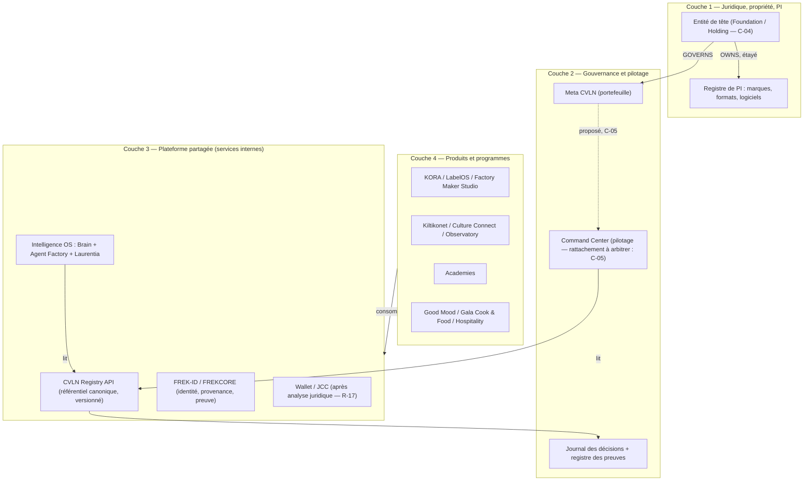

# 07 — Target Architecture (Phase 5 — PROPOSED)

- **Mission :** CVLN-GOV-RECON-001
- **Phase :** 5 — Architecture cible et plan d’intégration
- **Date :** 2026-10-11 (mise à jour 2026-10-12)
- **Statut :** **PROPOSITION** — aucune décision d’architecture n’est prise ici (mandat §11, règle 7)

Ce document ne remplace pas l’architecture fondatrice. Il propose comment passer de l’état observé (deux applications générées par Emergent, un registre gelé non validé, aucune intégration) à un **système de groupe** : souverain, traçable et capable de passer à l’échelle.

## 1. Constat de départ (résumé des Phases 0–3)

| Dimension | État observé |
|---|---|
| Vision | Riche et structurée (29 entités, doctrine JCC), mais validation des rattachements non tracée (C-01) |
| Code | 2 applications isolées : vitrine + registre (Next.js), Command Center (FastAPI/React) |
| Intégration | Aucune entre les deux ; aucune couche IA réalisée (Intelligence OS, Brain, Agent Factory, Laurentia = documentés uniquement) |
| Référentiel | Deux registres d’entités divergents (C-06) |
| Souveraineté | Dépendance complète à Emergent pour produire, tester et prévisualiser le code |
| Sécurité | Incidents d’exposition dans un dépôt public (R-13), contrôle d’accès incohérent (C-07, corrigé sur branche) |
| Juridique / PI | Aucune pièce ; structure de tête ambiguë (C-04, C-09) |

## 2. Principes directeurs proposés

Les références sont les standards des groupes technologiques mondiaux, pas seulement ceux de l’industrie culturelle :

1. **Une seule source de vérité par type de fait.** Entités et relations : le registre canonique. Code : GitHub. Décisions : le journal des décisions. Preuves : le registre des preuves. C’est la discipline des grands groupes : référentiel d’entités unique, « single source of truth ».
2. **Plateforme d’abord, produits ensuite.** Chaque brique (registre, identité FREK-ID, preuve, agents) est conçue comme un **service interne avec un contrat d’API versionné**, consommable par tous les produits (KORA, LabelOS, Command Center, …). C’est la logique des primitives réutilisables des plateformes mondiales.
3. **Souveraineté du code et des données.** Le groupe possède son code, son historique, sa CI et ses déploiements. Les générateurs (Emergent ou autres) sont des **outils de production** qui livrent par branche et revue, pas des lieux de vérité.
4. **Séparation stricte des couches.** Juridique et propriété ≠ gouvernance ≠ structure produit ≠ dépendance technique (mandat §3). Chaque couche a ses relations propres (`OWNS`, `GOVERNS`, `PART_OF`, `DEPENDS_ON`), étayées par leur propre type de preuve.
5. **La propriété intellectuelle comme actif central.** Marques, noms, formats (`.FK`, FREKANSLA, FREKRAW), logiciels et catalogues sont inventoriés, détenus par une entité identifiée et protégés avant toute exposition publique.
6. **Sécurité par défaut.** Dépôts internes privés, secrets hors du code, branches protégées, CI obligatoire, revue avant fusion.

## 3. Architecture cible en quatre couches

## 4. Responsabilités et contrats proposés

| Composant | Responsabilité | Contrat initial proposé | Prérequis |
|---|---|---|---|
| CVLN Registry | Référentiel unique des entités, relations, statuts et preuves | `GET /api/registry/export` (existant, versionné par `schema_version` et baseline) ; ajout additif de 9 des champs du mandat §9 absents du registre (PROP-03) ; `actual_role`, `source_documents`, `dependencies`, `known_contradictions` et `next_action` restent à arbitrer | C-01 (validation), CI d’intégrité (fait sur branche) |
| Command Center | Pilotage opérationnel et financier | Lecture du registre ; ses projets référencent des `entity_id` canoniques (PROP-07) | C-06, sécurité (C-07 corrigé sur branche, R-13) |
| Intelligence OS / Brain / Agent Factory / Laurentia | Couche IA partagée | À spécifier ; première entrée : lecture du registre (HIST-01 : ne pas brancher sans décision) | Décision explicite de branchement ; C-03 |
| FREKCORE / FREK-ID / Proof Layer | Identité, provenance, preuve | À spécifier ; aucune réalisation trouvée | C-02 ; analyse juridique de la « valeur notariale » |
| Wallet / JCC | Économie interne | Aucun contrat avant analyse réglementaire | R-17 |

## 5. Dépendances : acceptées, remplaçables, à éliminer

| Dépendance | Proposition | Justification |
|---|---|---|
| Emergent comme générateur de code | **Remplaçable** — conserver comme outil, retirer comme source de vérité | R-02, R-15 |
| Emergent comme identité Git, CI et hébergement de prévisualisation | **À éliminer** progressivement | Souveraineté, reproductibilité |
| Paquet `emergentintegrations` non utilisé (Command Center) | **À éliminer** | Dépendance morte |
| MongoDB | **Acceptée** (instance et hébergeur à identifier) | Choix technique standard |
| GitHub | **Acceptée** — passer d’un compte personnel à une organisation du groupe | R-19 |
| Google Fonts | **Acceptée / remplaçable** | Faible enjeu |

## 6. Ce qui n’est pas proposé

- Aucune suppression, fusion ou renommage d’entité du registre.
- Aucune modification de la baseline v1 gelée.
- Aucun branchement d’Intelligence OS sans décision (HIST-01).
- Aucune requalification de JCC (HIST-03).
